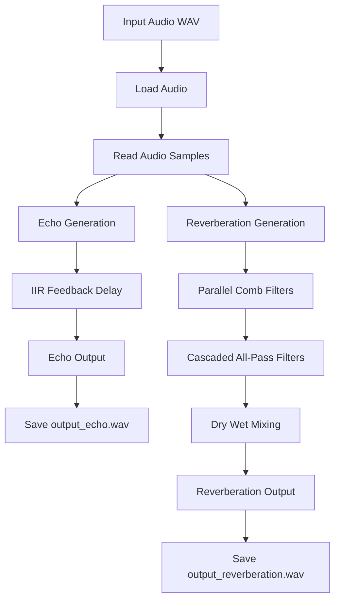
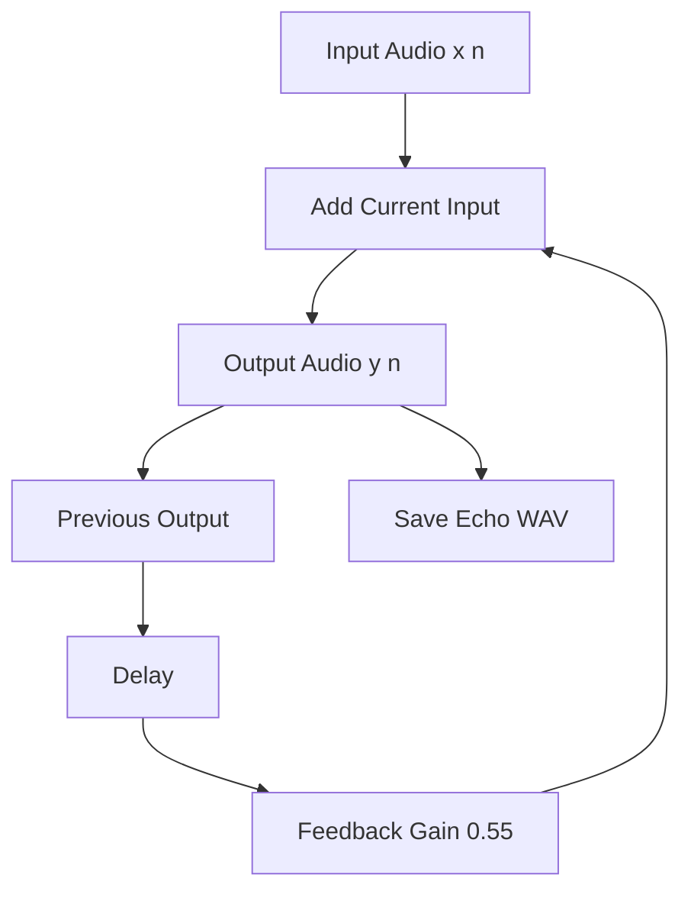
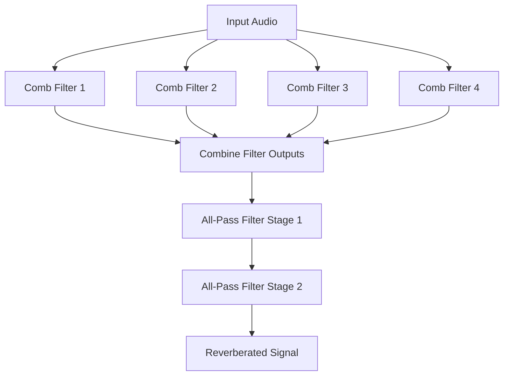

# DSP IIR Echo and Reverberation Generation

A Digital Signal Processing (DSP) assignment implementing audio echo and reverberation generation using Python. The project applies IIR feedback delay, comb filters, all-pass filters, and dry/wet mixing to a digital audio signal.

## Overview

This project demonstrates how digital audio effects can be generated using recursive digital filters.

The input audio is processed through two separate paths:

- **Echo generation:** Uses a feedback delay system to produce repeated delayed versions of the original audio.
- **Reverberation generation:** Uses parallel comb filters followed by cascaded all-pass filters to create a reverberation effect.

The processed audio is saved as WAV files for listening and comparison with the original input.

## Objectives

- Implement echo generation using an IIR feedback delay structure.
- Generate reverberation using parallel comb filters and cascaded all-pass filters.
- Understand the role of delay, feedback, and filter coefficients in audio processing.
- Apply dry and wet signal mixing.
- Process audio using Python and numerical signal processing libraries.
- Save the generated audio effects as WAV files.

## Technologies Used

| Component | Technology |
|---|---|
| Programming language | Python |
| Numerical processing | NumPy |
| Audio processing | SciPy |
| Plotting | Matplotlib |
| Audio format | WAV |

## Project Structure

```text
DSP_IIR_Echo_Reverberation/
│
├── main.py
│
├── input_audio.wav
├── input_audio1.wav
│
├── output_echo.wav
├── output_reverberation.wav
│
├── .vscode/
│
└── README.md
```

## System Flow

The project processes the input audio separately for echo and reverberation generation.



## 1. Echo Generation

Echo is generated by adding a delayed version of the input signal to the current input, while feeding a portion of the previous output back into the system.

The implemented echo system uses an IIR feedback delay structure.

### Difference Equation

The echo system follows:

\[
y[n]=x[n]+g\,y[n-D]
\]

Where:

- \(x[n]\) = Input audio sample
- \(y[n]\) = Output audio sample
- \(g\) = Feedback gain
- \(D\) = Delay in samples

The delayed output is added to the current input, producing an echo. The feedback term allows the delayed signal to repeat with decreasing amplitude.

### Implemented Parameters

| Parameter | Value |
|---|---|
| Delay | 250 ms |
| Feedback gain | 0.55 |
| Filter type | IIR feedback delay |

The feedback gain controls how much of the previous output is returned to the system.

A feedback gain of 0.55 reduces the amplitude of each successive echo, allowing the repetitions to decay over time.

### Echo Processing Flow



## 2. Reverberation Generation

Reverberation is generated by combining multiple delayed reflections and processing them through filters.

The implemented reverberation system consists of:

1. Parallel comb filters
2. Cascaded all-pass filters
3. Dry/wet signal mixing

### Parallel Comb Filters

Four parallel comb filters are used to generate delayed and feedback-based components.

Each comb filter has its own delay and feedback gain.

The comb filter structure follows:

\[
y[n]=x[n]+g\,y[n-D]
\]

The delayed output is fed back and combined with the input to generate repeated reflections.

Using different delay values allows the comb filters to produce different reflection patterns.

The outputs of the parallel comb filters are combined before being passed to the all-pass stages.

### Comb Filter Processing



### All-Pass Filters

Two cascaded all-pass filter stages are used after the parallel comb filters.

The implemented delay values are:

| Filter stage | Delay |
|---|---|
| All-pass stage 1 | 5 ms |
| All-pass stage 2 | 1.7 ms |

All-pass filters modify the phase response while maintaining a flat magnitude response in the ideal case.

Their purpose in this implementation is to further process the reflections produced by the comb filters and improve the reverberation effect.

The two stages are connected in series, meaning the output of the first all-pass filter becomes the input of the second.

### Dry/Wet Mixing

The final reverberation output is generated by mixing the original input audio with the processed reverberated signal.

The implemented mixing proportions are:

| Signal | Gain |
|---|---|
| Dry signal | 0.60 |
| Wet signal | 0.40 |

The mixing equation is:

\[
y[n]=0.6x[n]+0.4r[n]
\]

Where:

- \(x[n]\) = Original input signal
- \(r[n]\) = Processed reverberation signal
- \(y[n]\) = Final mixed output

The dry signal preserves the original audio, while the wet signal adds the reverberation effect.

## 3. Audio Processing

The program loads the input audio and processes its samples using the implemented filter structures.

The audio processing sequence is:

1. Load the input WAV file.
2. Read the audio samples.
3. Generate the echo using the IIR feedback delay.
4. Generate reverberation using parallel comb filters.
5. Process the comb filter output through two all-pass stages.
6. Mix the original and reverberated signals.
7. Save the generated audio files.

## Output Files

The program generates the following audio files:

| File | Description |
|---|---|
| `output_echo.wav` | Audio processed using the IIR feedback delay system |
| `output_reverberation.wav` | Audio processed using comb filters, all-pass filters, and dry/wet mixing |

The output files can be played to compare the generated effects with the original input audio.

## How to Run

### Requirements

Python and the following libraries are required:

- NumPy
- SciPy
- Matplotlib

Install the required libraries:

```bash
pip install numpy scipy matplotlib
```

### Execution

Place the input audio WAV file in the project directory.

Run:

```bash
python main.py
```

The program processes the audio and saves the generated echo and reverberation WAV files.

## Current Implementation

The project currently implements:

- WAV audio input.
- IIR feedback-based echo generation.
- 250 ms echo delay.
- 0.55 echo feedback gain.
- Four parallel comb filters for reverberation.
- Two cascaded all-pass filter stages.
- 5 ms and 1.7 ms all-pass delays.
- Dry/wet mixing using 0.60 and 0.40 gains.
- WAV output generation for echo and reverberation.

## Future Implementation

The following improvements can be added in future versions:

- Allow the user to change echo delay and feedback gain.
- Add adjustable reverberation parameters.
- Allow selection of input audio through command-line arguments.
- Add waveform and frequency-response comparisons between original and processed audio.
- Improve the interface for selecting and listening to generated effects.

## Conclusion

This project demonstrates the implementation of echo and reverberation generation using digital signal processing techniques.

The echo system uses an IIR feedback delay structure to generate repeated audio reflections. The reverberation system combines parallel comb filters, cascaded all-pass filters, and dry/wet mixing to produce the processed audio output.

The project provides a practical implementation of recursive filtering and delay-based audio effects using Python.

